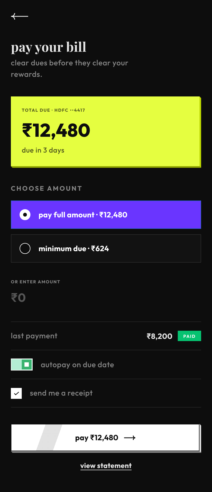

# NeoPOP design skill (unofficial)

An agent skill that teaches AI coding agents to build UIs in **NeoPOP**, the open-source design language from [CRED](https://github.com/CRED-CLUB). That means hard-edged 3D "plunk" buttons, a black-first palette, bold type and lowercase copy.



## What's inside

`neopop-design/SKILL.md` is a single self-contained skill. It includes:

- a drop-in `neopop.css` with every colour token, the type scale, the exact 45° edge geometry, the press animation and all components (buttons, cards, inputs, checkbox, radio, toggle, tags, toasts, bottom sheet)
- the edge-colour rule for any custom accent colour
- paths for plain HTML, Tailwind v4, DaisyUI 5 and React (`@cred/neopop-web`)
- a checklist the agent runs before finishing

## Install

**Any agent (Claude Code, Cursor, Codex, Copilot, Gemini CLI and more)**:

```sh
npx skills add Satyam085/neopop-design-skill
```

**Claude Code (plugin)**:

```
/plugin install neopop-design --marketplace Satyam085/neopop-design-skill
```

On Claude Code older than 2.1.275, add the marketplace first:

```
/plugin marketplace add Satyam085/neopop-design-skill
/plugin install neopop-design@neopop-design-skill
```

**Claude Code (manual)**: copy the skill folder into your personal or project skills:

```sh
git clone https://github.com/Satyam085/neopop-design-skill
cp -r neopop-design-skill/neopop-design ~/.claude/skills/      # every project
# or: cp -r neopop-design-skill/neopop-design .claude/skills/  # one repo, shared via git
```

**Claude apps (web/desktop)**: download `neopop-design.zip` from the latest release, then go to **Customize → Skills** and upload it.

**Other agents**: any tool that supports the Agent Skills format (a folder containing `SKILL.md`) can load the `neopop-design` folder. Otherwise, point the agent at `neopop-design/SKILL.md` from its instructions file.

Then just ask: *"build a credit-card bill payment screen, CRED style"*, *"make this settings page neopop"*.

## Fonts

NeoPOP uses Gilroy and PP Cirka, which are commercial typefaces and are **not** included here. The skill falls back to the free Google Fonts **Outfit** and **Playfair Display**. If you hold licences for the originals, self-host them and they'll be picked up first.

## Credits

NeoPOP was designed and built by **CRED** (Dreamplug Technologies Private Limited) and released under the Apache License 2.0:

- [CRED-CLUB/neopop-web](https://github.com/CRED-CLUB/neopop-web): colour palette, typography system, component measurements, CSS geometry, SVG icons
- [CRED-CLUB/neopop-android](https://github.com/CRED-CLUB/neopop-android): the edge-colour (HSL) rule

This skill adapts that work and changes it, as listed in [`NOTICE`](neopop-design/NOTICE). It's an unofficial project, not affiliated with or endorsed by CRED. All credit for the design language goes to the CRED design and engineering teams.

## License

Apache License 2.0, the same licence as NeoPOP. See [`LICENSE`](LICENSE) and [`NOTICE`](neopop-design/NOTICE). If you redistribute this skill or the CSS inside it, keep the licence, the NOTICE file and the header comment in `neopop.css`.

Adaptation © 2026 Satyam Singh.
